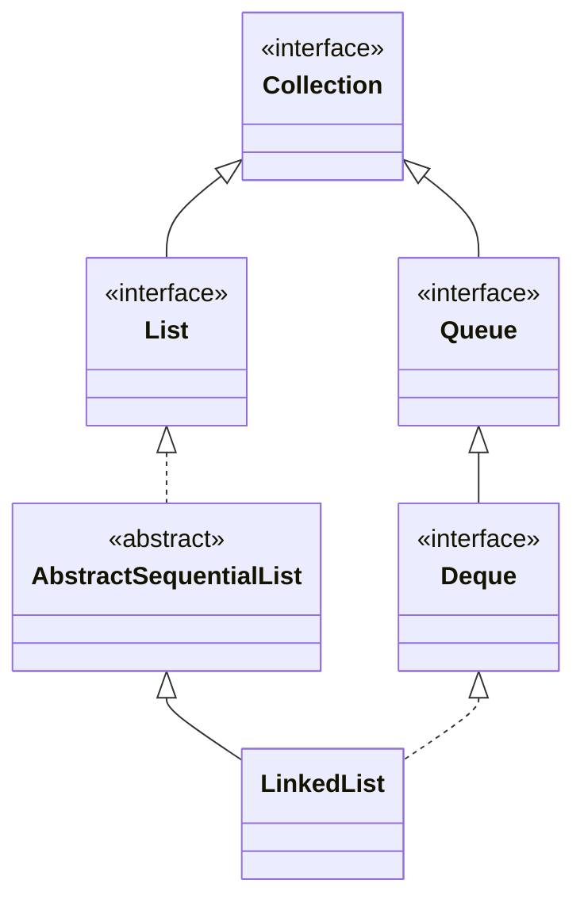

## Objective

Understand `LinkedList`, a doubly-linked-list-backed collection that implements `List`, `Deque`, and `Queue` at once — the same object can be treated as an indexable sequence, a double-ended queue, or a FIFO/stack, depending on which methods the caller reaches for.

## Use Cases

- Frequent insertion or removal at both ends, or in the middle once already positioned there, without the shifting cost `ArrayList` pays.
- Using a single collection type as a stack, a queue, or a positional list, without picking a different class for each role.
- Implementing algorithms that walk the list sequentially (via `Iterator`/`ListIterator`) rather than jumping to arbitrary indexes.

## Deep Dive

### LinkedList extends AbstractSequentialList

```java
class LinkedList<E>
```

`LinkedList` implements `List<E>`, `Deque<E>`, and (transitively, through `Deque`) `Queue<E>`. Two constructors:

```java
LinkedList<String> ll = new LinkedList<>();
LinkedList<String> ll2 = new LinkedList<>(List.of("a", "b"));
```



### Deque methods on a List

Because `LinkedList` implements `Deque`, both ends are addressable directly, instead of only through `List`'s index-0/index-`size()-1` positions:

```java
LinkedList<String> ll = new LinkedList<>();
ll.add("F"); ll.add("B"); ll.add("D"); ll.add("E"); ll.add("C");
ll.addLast("Z");
ll.addFirst("A");
ll.add(1, "A2");          // List-style positional insert
// ll: [A, A2, F, B, D, E, C, Z]

ll.remove("F");            // Collection-style remove by value
ll.remove(2);               // List-style remove by index
ll.removeFirst();
ll.removeLast();
```

`getFirst()`/`peekFirst()` and `getLast()`/`peekLast()` mirror the throwing-vs-reporting split `Deque` uses everywhere else.

### Watch it happen: addFirst() growing from the head

Each `addFirst()` lands at the front — slot 0 below is the head, an O(1) insert since it's just a new node linked in, not a shift of every other element the way `ArrayList.add(0, e)` would be:

```viz
type: formula
capacity = count
slot = capacity - 1 - index
---
A
B
C
D
```

The last one in (`D`) sits at slot 0. Compare this to `ArrayList`'s viz — same four elements, opposite placement rule.

### Positional access still works, just not efficiently

```java
String val = ll.get(2);
ll.set(2, val + " Changed");
```

`get`/`set` are still available because `LinkedList` implements `List`, and they still validate the index the same way `ArrayList`'s do — the difference is in how the element is located, not in the method contract.

## Trade-offs

- **`get(index)` is O(n), not O(1)** — `LinkedList` has no random-access array to jump into, so reaching index `i` means walking `i` nodes from whichever end is closer:

  ```java
  LinkedList<Integer> ll = new LinkedList<>();
  for (int i = 0; i < 100_000; i++) ll.add(i);
  ll.get(99_999); // walks the list to get there — no shortcut
  ```

  This is the mirror image of `ArrayList`'s trade-off.
- **`LinkedList` does not implement `RandomAccess`** — code that branches on `instanceof RandomAccess` (as some JDK algorithms in `Collections` do) falls back to iterator-based traversal instead of index-based loops when handed a `LinkedList`.
- **Every element is wrapped in a node object**, carrying prev/next references alongside the value — more per-element memory overhead than `ArrayList`'s flat backing array, independent of how many elements are stored.
- **Not synchronized**, same as `ArrayList` — concurrent structural modification (including during iteration) is unsafe and typically surfaces as `ConcurrentModificationException`.

## Lab

In this lab you get the `PlaybackQueue` class, which wraps a `LinkedList<String>`, and you use `LinkedList` as both a `List` and a `Deque` at once. The core idea is that the same structure serves an ordinary queue (wait your turn) and "play next" (jump the line), because it offers operations at both ends on top of the positional ones.

**The scenario**

A playback queue has the front track playing right now. New tracks wait at the back, some jump to the front, and skipping a track removes the current one.

- `PlaybackQueue.java`: holds `queue` (a `LinkedList<String>`). `size()` is already written. You implement the other methods.

**What you will do, step by step**

1. **Join the back of the queue (TODO-00).** In `enqueue()`, add the track at the end: the normal addition, from someone waiting their turn.
2. **Jump the line (TODO-01).** In `playNext()`, add the track at the FRONT, so it plays right after whatever is playing now, ahead of everything already queued. Think about which `Deque` method does this in a single operation.
3. **Peek at the current track (TODO-02).** In `nowPlaying()`, return the front track WITHOUT removing it. If the queue is empty, let the natural exception happen, without catching and rethrowing.
4. **Skip (TODO-03).** In `skip()`, remove and return the front track, again letting the natural exception happen on an empty queue. The difference between methods that throw and methods that return `null` is exactly the point: pick the variant that throws.

**How you know you are done**

`mvn test` is all green. You should be able to explain the difference between `nowPlaying()` and `skip()` in terms of who changes the queue, and what happens with an empty queue in each.

**Optional challenges**

- **TODO-04:** implement `insertAt()`, inserting the track at the given position (0 is the front) with the `List`-style positional insertion that `LinkedList` also offers.

**Prerequisites:** basic Java syntax and familiarity with `List` and `Deque`.

**How to run it:** clone the repository, go into `java-concepts/linked-list` and run `mvn test` (or, from the root, `mvn -pl java-concepts/linked-list test`). The pending methods throw `UnsupportedOperationException("Not implemented yet.")` with a `TODO-NN` comment, so the red tests are your checklist.

## Documentation Links

- *Java: The Complete Reference*, 12th Edition (Herbert Schildt) — Chapter 20, pp. 589–590 — book
- [LinkedList — Java SE 25 API](https://docs.oracle.com/en/java/javase/25/docs/api/java.base/java/util/LinkedList.html) — doc
- [Deque — Java SE 25 API](https://docs.oracle.com/en/java/javase/25/docs/api/java.base/java/util/Deque.html) — doc
- [List — Java SE 25 API](https://docs.oracle.com/en/java/javase/25/docs/api/java.base/java/util/List.html) — doc
