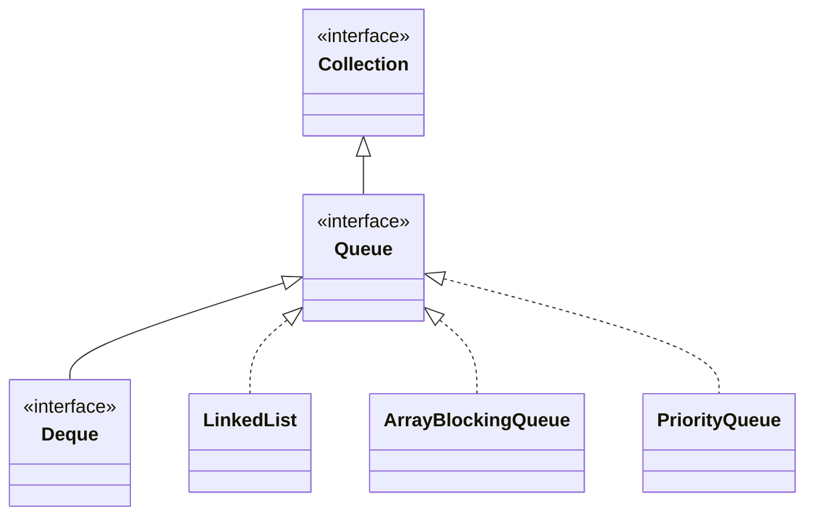

## Objective

Understand `Queue`: a `Collection` that declares the behavior of a queue — often first-in, first-out, though some implementations order elements by other criteria (a `PriorityQueue`, for instance, orders by priority, not arrival order). `Queue` is built around two parallel method pairs: one family throws on failure, the other reports it through a return value.

## Use Cases

- Modeling a work queue where items are processed in the order they arrive.
- Peeking at the next item without committing to removing it, before deciding how to handle it.
- Working with a bounded or fixed-length queue, where "the queue is full" is an expected condition to handle, not an exceptional one.
- Choosing between an operation that throws on an empty queue and one that returns `null`, depending on whether "empty" is a bug or a normal state for the caller.
- Building a priority-ordered or otherwise custom-ordered processing pipeline while still working against the generic `Queue` type.

## Deep Dive

### Queue extends Collection

```java
interface Queue<E>
```

`E` specifies the type of objects the queue will hold. Several of `Queue`'s methods throw `ClassCastException` when an object is incompatible with the elements already in the queue, `NullPointerException` when `null` isn't allowed, and `IllegalArgumentException` if an invalid argument is used — the same exception vocabulary `Collection` uses elsewhere.



### Adding: add() vs. offer()

`add()` (inherited from `Collection`) throws if it can't add the element. `offer()` is `Queue`'s own method for the same job, but it reports failure instead of throwing:

```java
Queue<Integer> q = new ArrayBlockingQueue<>(1); // fixed capacity: 1
q.add(10);          // true, added
q.add(20);           // IllegalStateException: queue full
```

```java
Queue<Integer> q = new ArrayBlockingQueue<>(1);
q.add(10);
boolean added = q.offer(20); // false — reports the failure instead of throwing
```

### Looking without removing: element() vs. peek()

Both return the element at the head of the queue without removing it. They differ only in how they handle an empty queue:

```java
Queue<String> q = new LinkedList<>();
q.element(); // NoSuchElementException — queue is empty
q.peek();    // null — queue is empty
```

### Removing: remove() vs. poll()

Both remove and return the element at the head of the queue. Same split on empty:

```java
Queue<String> q = new LinkedList<>();
q.remove(); // NoSuchElementException — queue is empty
q.poll();   // null — queue is empty
```

### Choosing a pair based on how "empty" or "full" should be handled

The two families exist so a caller can pick the failure mode that fits the situation: `add()`/`remove()`/`element()` are appropriate when an empty or full queue is a bug the caller wants surfaced immediately; `offer()`/`poll()`/`peek()` are appropriate when it's an expected outcome the caller will branch on.

```java
if (queue.offer(item)) {
    // handle success
} else {
    // queue full — handle without a try/catch
}
```

## Trade-offs

- **The exception-throwing pair and the null/false-returning pair aren't interchangeable** — swapping `element()`/`remove()` for `peek()`/`poll()` (or vice versa) changes how an empty queue is reported, from an exception to a sentinel value:

  ```java
  Queue<String> q = new LinkedList<>();
  q.element(); // NoSuchElementException
  q.peek();    // null
  ```
- **A fixed-length queue makes add() throw where offer() would just report false** — this only shows up once the queue is actually bounded (e.g., `ArrayBlockingQueue`), not with an unbounded one like `LinkedList`:

  ```java
  Queue<Integer> q = new ArrayBlockingQueue<>(1);
  q.add(1);
  q.add(2); // IllegalStateException: queue full
  ```
- **null doubles as the "empty queue" sentinel for peek()/poll()**, so a queue that actually stored `null` as an element would make "empty" indistinguishable from "head is null." Most `Queue` implementations sidestep the ambiguity by disallowing `null` outright:

  ```java
  Queue<String> q = new LinkedList<>();
  q.add(null); // NullPointerException — null elements are not allowed
  ```
- **FIFO is a convention some implementations choose, not a guarantee `Queue` itself makes** — a `PriorityQueue` implements the same interface but orders elements by priority rather than insertion order, so code that assumes strict first-in-first-out behavior from the `Queue` type alone is assuming more than the interface promises.

## Lab

In this lab you get `TicketCounter`, a fixed-capacity service line, with four empty methods. Your job is to implement them, picking the right `Queue` variant in each case. The core idea is to feel the two parallel method families: the ones that throw when they fail and the ones that report it through a return value (`false` or `null`).

**The scenario**

A line of customers with a size limit.

- `TicketCounter`: holds the line in `line`, an `ArrayBlockingQueue<String>` created with the capacity given to the constructor. `waiting()` (how many are waiting) is already done.
- `tryEnqueue(customer)`: tries to join the line.
- `nextInLine()`: peeks at who is next, without removing them.
- `serveNext()`: serves the next customer and removes them.
- `serveNextOrNull()`: the same, but without throwing.

Since the queue is bounded, "full" and "empty" are real situations, and the tests exercise both.

**What you will do, step by step**

1. **Join without blowing up (TODO-00).** Use `offer()`, which returns `false` when the line is full instead of throwing `IllegalStateException` like `add()` would.
2. **Peek at the head (TODO-01).** Use `peek()`, which returns `null` if the line is empty and removes nobody.
3. **Serve with an exception (TODO-02).** Use `remove()`, which throws `NoSuchElementException` on an empty line. Here an empty line is a caller bug.
4. **Serve without an exception (TODO-03).** Use `poll()`, which does the same job but returns `null` when nobody is there.

**How you know you are done**

`mvn test` is all green, including the FIFO order (first in, first out). You should be able to say when you prefer each family: an exception when the invalid state is a programming error, a special return value when it is a normal situation.

**Optional challenges**

- **BONUS-00:** implement `drainAll()`, returning a `List<String>` with every remaining customer, in order, emptying the line by polling repeatedly until it is empty.

**Prerequisites:** basic Java syntax and the `Collection` interface. The project uses Java 21 and Maven.

**How to run it:** clone the repository, go into `java-concepts/queue-interface` and run `mvn test` (from the root: `mvn -pl java-concepts/queue-interface test`). The methods start out throwing `UnsupportedOperationException("Not implemented yet.")` and the `TODO-NN` comments carry hints, so the red tests are your checklist.

## Documentation Links

- [Queue — Java SE 25 API](https://docs.oracle.com/en/java/javase/25/docs/api/java.base/java/util/Queue.html) — doc
- [Collection — Java SE 25 API](https://docs.oracle.com/en/java/javase/25/docs/api/java.base/java/util/Collection.html) — doc
