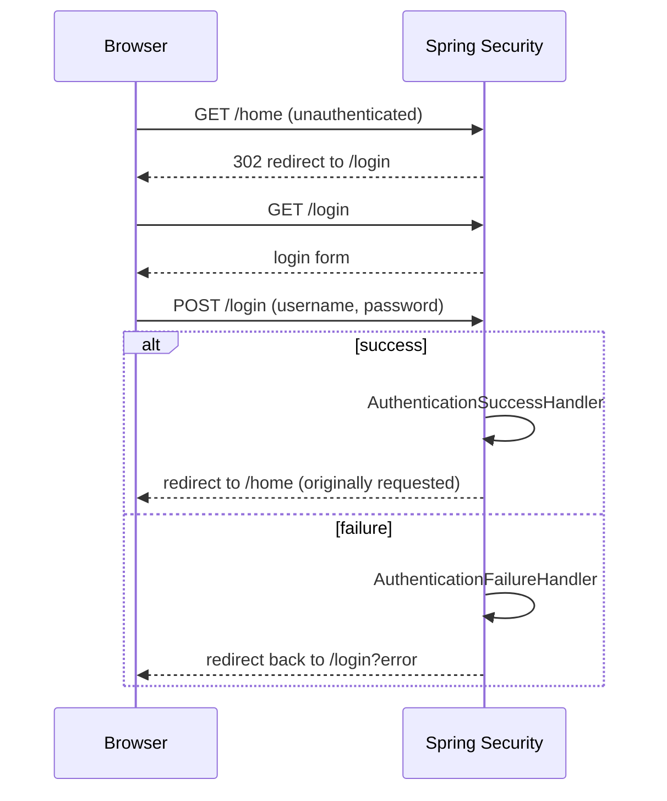

## Objective

HTTP Basic and form-based login are Spring Security's two built-in ways to collect
a username and password from a client. HTTP Basic is the simplest possible
mechanism — credentials ride along on every request as a header — which makes it
excellent for demos, proofs of concept, and machine-to-machine calls, but a poor
fit for anything with a browser-facing UI. Form-based login trades that simplicity
for exactly what a small web application needs: an actual login page, a session
that remembers the authenticated user across requests, and a logout flow — all
autoconfigured with a single method call, then customizable in layers as real
requirements show up.

## Use Cases

- Securing a small web application end to end: an unauthenticated visitor is
  redirected to a login form, and after a successful login, is sent back to the
  page they originally tried to reach.
- Returning a custom error response (a specific header, a different HTTP status,
  a request ID for tracing) instead of Spring Security's default behavior when
  authentication fails, for either HTTP Basic or form login.
- Redirecting different users to different pages after a successful login, based
  on their granted authorities.
- Supporting both authentication methods on the same application at once — HTTP
  Basic for API/tooling clients using `curl`, form login for browser users — with
  a single security configuration.

## Deep Dive

### HTTP Basic: minimal setup, then a custom realm and entry point

The bare-minimum way to require HTTP Basic authentication is a single call:

```java
@Configuration
public class ProjectConfig extends WebSecurityConfigurerAdapter {

    @Override
    protected void configure(HttpSecurity http) throws Exception {
        http.httpBasic();
    }
}
```

`httpBasic()` also accepts a `Customizer<HttpBasicConfigurer<HttpSecurity>>`,
which is how finer details — like the realm name sent back in the
`WWW-Authenticate` header on a failed request — get set:

```java
@Override
protected void configure(HttpSecurity http) throws Exception {
    http.httpBasic(c -> {
        c.realmName("OTHER");
    });

    http.authorizeRequests().anyRequest().authenticated();
}
```

A `curl -v` against a protected endpoint with no credentials now shows
`WWW-Authenticate: Basic realm="OTHER"` — but only on a `401 Unauthorized`
response; a successful `200 OK` never carries that header at all.

### Customizing an authentication failure: AuthenticationEntryPoint

Beyond the realm name, a completely custom response body or header set on
authentication failure needs an `AuthenticationEntryPoint`. Its `commence()`
method receives the request, the response, and the `AuthenticationException`
that triggered the failure:

```java
public class CustomEntryPoint implements AuthenticationEntryPoint {

    @Override
    public void commence(
        HttpServletRequest httpServletRequest,
        HttpServletResponse httpServletResponse,
        AuthenticationException e)
            throws IOException, ServletException {

        httpServletResponse.addHeader("message", "Luke, I am your father!");
        httpServletResponse.sendError(HttpStatus.UNAUTHORIZED.value());
    }
}
```

Registered alongside the realm name:

```java
@Override
protected void configure(HttpSecurity http) throws Exception {
    http.httpBasic(c -> {
        c.realmName("OTHER");
        c.authenticationEntryPoint(new CustomEntryPoint());
    });

    http.authorizeRequests().anyRequest().authenticated();
}
```

`AuthenticationEntryPoint` is invoked by `ExceptionTranslationManager`, the
component that bridges Java exceptions thrown inside the filter chain
(`AuthenticationException`, `AccessDeniedException`) back into HTTP responses
— the name doesn't obviously suggest "runs on authentication failure," which is
worth knowing before hunting for a differently-named interface.

### Form login: an autoconfigured login page, with zero HTML written

Switching `httpBasic()` for `formLogin()` is enough to get a working login page,
session handling, and a logout endpoint, with no HTML written by the
application:

```java
@Configuration
public class ProjectConfig extends WebSecurityConfigurerAdapter {

    @Override
    protected void configure(HttpSecurity http) throws Exception {
        http.formLogin();
        http.authorizeRequests().anyRequest().authenticated();
    }
}
```

Without a registered `UserDetailsService`, the default `user`/generated-UUID
credentials (the same ones introduced in earlier chapters) log in against this
form exactly as they would against HTTP Basic. A protected page still needs a
normal `@Controller` (not `@RestController`) returning a view name, so the
response is renderable HTML rather than a JSON body:

```java
@Controller
public class HelloController {

    @GetMapping("/home")
    public String home() {
        return "home.html";
    }
}
```

An unauthenticated visit to `/home` is redirected to the login form first; after
a successful login, Spring Security sends the browser back to `/home` — the page
originally requested — rather than to a fixed landing page.

### Redirecting after login: defaultSuccessUrl and the two handler interfaces

`formLogin()` returns a `FormLoginConfigurer<HttpSecurity>`, whose
`defaultSuccessUrl()` fixes the post-login destination regardless of which page
triggered the login redirect:

```java
@Override
protected void configure(HttpSecurity http) throws Exception {
    http.formLogin()
        .defaultSuccessUrl("/home", true);

    http.authorizeRequests().anyRequest().authenticated();
}
```

For logic that depends on *who* logged in — different redirects per granted
authority, for instance — `AuthenticationSuccessHandler` gives full control
over the response:

```java
@Component
public class CustomAuthenticationSuccessHandler
    implements AuthenticationSuccessHandler {

    @Override
    public void onAuthenticationSuccess(
        HttpServletRequest httpServletRequest,
        HttpServletResponse httpServletResponse,
        Authentication authentication)
            throws IOException {

        var authorities = authentication.getAuthorities();

        var auth = authorities.stream()
            .filter(a -> a.getAuthority().equals("read"))
            .findFirst();

        if (auth.isPresent()) {
            httpServletResponse.sendRedirect("/home");
        } else {
            httpServletResponse.sendRedirect("/error");
        }
    }
}
```

Its mirror image, `AuthenticationFailureHandler`, does the equivalent for a
failed login — here, stamping a timestamp header on every failed attempt:

```java
@Component
public class CustomAuthenticationFailureHandler
    implements AuthenticationFailureHandler {

    @Override
    public void onAuthenticationFailure(
        HttpServletRequest httpServletRequest,
        HttpServletResponse httpServletResponse,
        AuthenticationException e) {

        httpServletResponse.setHeader("failed", LocalDateTime.now().toString());
    }
}
```

Both are registered the same way, on the `FormLoginConfigurer`:

```java
@Override
protected void configure(HttpSecurity http) throws Exception {
    http.formLogin()
        .successHandler(authenticationSuccessHandler)
        .failureHandler(authenticationFailureHandler);

    http.authorizeRequests().anyRequest().authenticated();
}
```



### Running both methods together

Once `formLogin()` is configured, HTTP Basic credentials on their own stop
working — every unauthenticated request is redirected to the login form instead
(`302 Found`), even with a valid `Authorization` header attached. Chaining
`.httpBasic()` after `formLogin()` re-enables both at once:

```java
@Override
protected void configure(HttpSecurity http) throws Exception {
    http.formLogin()
        .successHandler(authenticationSuccessHandler)
        .failureHandler(authenticationFailureHandler)
    .and()
        .httpBasic();

    http.authorizeRequests().anyRequest().authenticated();
}
```

With both active, a browser gets the login form as before, and a `curl -u
user:password` call authenticates over HTTP Basic on the very same endpoint.

## Trade-offs

- **HTTP Basic sends credentials on every single request, in a header decoded
  with nothing more than Base64** — fine over TLS for scripted/API clients that
  already manage credentials securely, a poor fit for anything a human types
  into a browser, since there's no session, no logout, and no login page to
  build trust or add extra factors.
- **Form login trades HTTP Basic's statelessness for a server-side session** —
  the book is explicit that this fits a small application, not one that needs
  horizontal scalability, since a server-side session ties a user to whichever
  node holds it (or requires a shared session store to fix that). The book
  points forward to OAuth 2 (its chapters 12-15) as the answer for that case.
- **`AuthenticationEntryPoint`'s name doesn't describe what it does** — it's
  invoked specifically on authentication *failure*, via
  `ExceptionTranslationManager`, not on every request; reaching for a
  differently-named interface when hunting for "customize the failed-auth
  response" is an easy first guess to get wrong.
- **Combining `formLogin()` and `httpBasic()` isn't automatic — the presence
  of one silences the other unless both are explicitly chained.** A team
  assuming "HTTP Basic still works because I never removed it" after adding
  `formLogin()` will get a `302` redirect instead of the `401`/success they
  expect, until `.httpBasic()` is added back alongside it.
- **Book vs. today: the `.and()`-chained fluent style this section relies on
  throughout (`formLogin()...and().httpBasic()`) is scheduled for removal in
  Spring Security 7**, in favor of the Lambda DSL exclusively — confirmed via
  the current Spring Security migration documentation. The equivalent
  configuration today reads:
  ```java
  http
      .formLogin(form -> form
          .successHandler(authenticationSuccessHandler)
          .failureHandler(authenticationFailureHandler)
      )
      .httpBasic(Customizer.withDefaults());
  ```
  Spring Security 7 also drops the no-argument `httpBasic()`/`formLogin()`
  calls this section uses for the minimal-configuration examples — a
  `Customizer` argument becomes mandatory, with `Customizer.withDefaults()` as
  the explicit stand-in for "use the defaults." The underlying mechanics
  (realm name, `AuthenticationEntryPoint`, `defaultSuccessUrl`,
  success/failure handlers) are unchanged — only the configuration syntax
  wrapping them is affected, the same `WebSecurityConfigurerAdapter`-to-
  `SecurityFilterChain`-bean migration already noted elsewhere in this
  workflow.

## Lab

In this lab you get a `SecurityConfig` with three empty methods and a protected endpoint ready. Your job is to set up security to accept **HTTP Basic and form login at the same time**. The core idea is that configuring only one of the two does not just "miss a feature": it can silence behavior you thought still worked.

**The scenario**

Every request requires authentication, with a single user `alice` / `password`.

- `SecurityConfig`: exposes a `PasswordEncoder`, a `UserDetailsService` and the `SecurityFilterChain`. All three throw `UnsupportedOperationException`.
- `GreetingController`: `GET /hello` returns `"Hello, " + authentication.getName()`.
- `SecurityConfigTest`: builds a `MockMvc` with `springSecurity()` and tests six situations: a Basic 401 challenge, a browser redirect to `/login`, successful Basic, Basic with a wrong password, form login creating a session, and form login with a wrong password going to `/login?error`.

**What you will do, step by step**

1. **Password encoder (TODO-00).** Return a `BCryptPasswordEncoder` from `passwordEncoder()`.
2. **In-memory user (TODO-01).** In `userDetailsService`, return an `InMemoryUserDetailsManager` with user `alice`, authority `ROLE_USER` and the password `password` encoded with the received `passwordEncoder`, using `User.withUsername(...)`.
3. **Require authentication (TODO-02).** In `securityFilterChain`, use `authorizeHttpRequests` with `anyRequest().authenticated()`.
4. **Turn on both mechanisms (TODO-03).** Enable `.formLogin(Customizer.withDefaults())` **and** `.httpBasic(Customizer.withDefaults())` on the same chain. With both, Spring Security picks the challenge by request: an API call gets a 401 with `WWW-Authenticate: Basic`, and a request with `Accept: text/html` is redirected to `/login`.
5. **Disable CSRF (TODO-04).** Use `.csrf(AbstractHttpConfigurer::disable)`, because the lab simulates an API client, not a browser form carrying a token.
6. **Close the chain (TODO-05).** Return `http.build()`.

**How you know you are done**

`mvn test` is green. You should be able to explain the difference between Basic (credentials on every request, no session) and form login (authenticate once and use the session), and what would happen if you removed `httpBasic()`.

**Prerequisites:** basic Spring Framework, `SecurityFilterChain` and `HttpSecurity` (see the user management lab) and some familiarity with `MockMvc`.

**How to run it:** clone the repository, go into `spring-concepts/spring-security-http-basic-and-form-login` and run `mvn test`. The tests fail while the `SecurityConfig` methods throw `UnsupportedOperationException`; the `TODO` comments say what to do in each one.

## Documentation Links

- Laurențiu Spilcă, "Spring Security in Action" (Manning, 2020) — Chapter 5, "Implementing authentication", section 5.3, p. 125-133 — doc
- [Spring Security Reference — Basic Authentication](https://docs.spring.io/spring-security/reference/servlet/authentication/passwords/basic.html) — doc
- [Spring Security Reference — Form Login](https://docs.spring.io/spring-security/reference/servlet/authentication/passwords/form.html) — doc
- [Spring Security Reference — Configuration Migrations (Spring Security 7, .and() removal, mandatory Customizer)](https://docs.spring.io/spring-security/reference/6.5/migration-7/configuration.html) — doc
